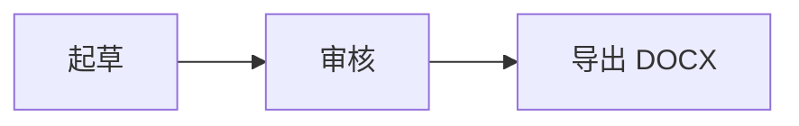

# Mermaid 图表

## 概述

在 ` ```mermaid ` 代码块中生成行内 SVG，支持悬停预览、主题适配、大图优化和中文错误提示。Mermaid 需要浏览器 DOM，当前实现使用懒创建的 VS Code webview，不使用 Node/JSDOM 或远程脚本冒充真实渲染。

## 实现

- `mermaid/mermaid-renderer.ts` 管理初始化与销毁；`webview-manager.ts` 仅在首个图表需要渲染时创建宿主。
- `assets/mermaid/` 是本地 Mermaid 12.3.0 ESM 入口与 chunks，由 `npm run copy:mermaid` 从声明依赖重新生成；不得手工编辑 vendor 文件。
- webview 使用随机 nonce、限制性 CSP 和 `securityLevel: 'strict'`；脚本不从 CDN 加载。
- 编辑器通过 decoration 显示 SVG data URI，选中代码块时恢复原始 Markdown。
- `svg-processor.ts` 与悬停逻辑负责尺寸限制、大图优化和 data URI 编码。
- 渲染失败保留源码并给出中文错误；资源、pending 请求和 webview 在关闭或停用时清理。

## 验收标准

```gherkin
Feature: Mermaid 行内图表

  Scenario: 基本图表
    When 文档包含 mermaid 代码块
    Then 行内显示 SVG

  Scenario: 非法语法
    When Mermaid 源码无法解析
    Then 显示中文错误且保留原始源码

  Scenario: 编辑源码
    When 光标选中图表代码块
    Then 显示原始 Markdown

  Scenario: 资源清理
    When 扩展停用或 webview 关闭
    Then 释放宿主与未完成请求
```

## 依赖升级边界

Mermaid 12.3.0 与 DOMPurify 安全 override 已落地，本地资产已重新生成，生产依赖审计为 0。本轮按用户要求未启动 Extension Host 或外部渲染，因此“资产与 CSP 源码已更新”不等于 Mermaid 12 的运行兼容性已验收。

恢复验证时至少覆盖：流程图、时序图、含中文标签、非法语法、深色/浅色主题、首次懒加载、连续更新和销毁清理。

更多背景见 [ADR: Mermaid 渲染](../../architecture/ADR/mermaid.md) 与 [Mermaid 踩坑记录](../../experience/mermaid-rendering-findings.md)。

## 边缘情况

- Mermaid 与 LaTeX 当前导出 DOCX 时保留占位文本或源码，不声称导出为原生 Word 图形。
- 非法语法、超大图、连续修改和 webview 销毁都必须保留可恢复路径。
- Mermaid 12.3.0 的真实渲染行为尚未验证。

## 示例

````markdown

````
